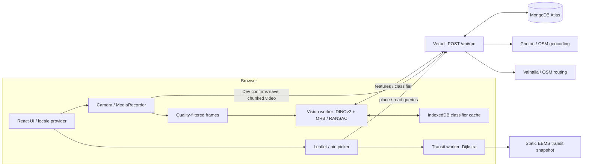

# NoSleepClub HIST

A mobile browser proof of concept for **visual place recognition from a five-second labelled video**, with an embedded Ho Chi Minh City route planner.

[Live HTTPS app](https://nosleepclub-hist-connected.vercel.app/) · [App QR](docs/qr-app.png) · [Release audit](docs/audit-localization.md)


## Runtime architecture



The server stores data and proxies map services; **vision inference runs in the browser**. User camera frames stay on the device. Dev recordings, reference features and the fitted classifier are uploaded when Dev saves a named clip. Map providers receive locations, not camera images.

| Module | Responsibility |
| --- | --- |
| `src/App.tsx` | Role flow, camera lifecycle, recording, save/retry, training/evaluation |
| `src/client.ts` | RPC client, room persistence, video transfer, worker request lifecycle |
| `src/vision.worker.ts` | Backbone initialization, embeddings, ORB extraction and homography verification |
| `src/fewshot.ts` | Prototype fitting, support selection, semantic ranking, artifact compatibility |
| `src/evidence.ts`, `recognition.ts` | Evidence thresholds, quality filter, temporal confirmation/expiry |
| `src/model-cache.ts`, `shared.ts` | IndexedDB and versioned feature/classifier contracts |
| `src/maps/MapsPanel.tsx` | Search, pin placement, routing and walking-leg verification |
| `src/maps/DestinationInput.tsx`, `PinButton.tsx` | Landmark combobox and pointer/tap pin controls |
| `src/maps/transit.ts`, `transit.worker.ts` | Directed transit graph, heap-based Dijkstra and worker adapter |
| `src/maps/landmarks.ts`, `maneuvers.ts` | Ten curated OSM places and structured navigation localization |
| `src/i18n/` | Typed five-language catalog, runtime message adapter, lazy font styles |
| `server/rpc.ts`, `validation.ts` | Authorization, quotas, lifecycle checks and validation |
| `server/db.ts`, `maps.ts` | Mongo indexes/pooling and cached, throttled map requests |
| `api/` | Vercel entry points; server imports need explicit `.js` ESM extensions |
| `scripts/assets.mjs`, `fetch-transit.mjs` | WASM assets and explicitly refreshed public transit dataset |

## Local development

Use **Node 24.22.1 or a later patched 24.x release** (`>=24.22.1 <25`).

```powershell
npm ci --ignore-scripts
Copy-Item .env.example .env.local
# Set MONGODB_URI in .env.local. Never commit its value.
npm run dev
```

UI: `http://127.0.0.1:5173`. Local API: `127.0.0.1:8787`, proxied through Vite. Restart the dev command after backend edits; the API is not hot reloaded. Camera access works over localhost HTTP; phones need the HTTPS deployment.

| Variable | Scope / meaning |
| --- | --- |
| `MONGODB_URI` | Required for API operations; server-only Atlas TLS connection URI |
| `MONGODB_DB` | Optional; defaults to `nosleepclub_hist` |

Never prefix secrets with `VITE_`, which exposes values to the client bundle. `.env*`, recordings, dependency caches, local tool runtimes and build output are ignored by Git.

```powershell
npm run typecheck
npm test
npm run build
npm audit --audit-level=high
```

Build checks TypeScript, copies ONNX Runtime WASM files into `public/ort`, then builds `dist`. WASM and fonts are self-hosted. Keep `assetsInlineLimit: 0`: inlined font URLs violate the production `font-src 'self'` policy.

## Recording and recognition

Choose a language, then **Dev**. Start the rear camera, record five seconds, name the place and save. Capture sampling runs every 200 ms independently of model inference; feature extraction happens after recording stops. Share **Library → Room QR** to load those references in User mode on another device. The generic QR above only opens the app.

“Training from five seconds” means fitting a lightweight classifier over frozen pretrained features, **not fine-tuning DINOv2**. A new device first downloads/initializes the backbone. Five-second capture does not promise five-second processing or zero startup latency. Later views must overlap stable visual details in the reference clip.

### Feature contract and preprocessing

* The pinned DINOv2 Small q8 backbone emits a 384-dimensional L2-normalized embedding. Exact model ID/revision are in `src/vision.worker.ts`.
* Feature version: `dinov2-small-q8-orb-v1`; artifact version: `fewshot-dinov2-v3`. Reuse requires matching versions and sorted reference footage IDs.
* The crop matches the viewfinder's `object-fit: cover`; the longer side is at most 512 px.
* Quality is measured at a consistent 256 px scale: mean luminance `[18,240]`, Laplacian variance `≥65`, plus usable ORB keypoints. This practical filter does not perfectly detect every motion blur.
* Up to eight time bins retain their sharpest frame. Stationary clips are valid; similar frames are not all discarded.
* ORB points are distributed across a 4×4 grid, capped at 250, with 32-byte descriptors.

### Fitting and inference

Labels use NFC normalization and case folding. Background clips form a rejection class. Up to three spherical prototypes preserve distinct viewpoints through six assignment/normalization iterations. Farthest-point support selection keeps at most 24 support frames overall, allocating 2–8 per class.

For normalized vectors, similarity is `s(q,x)=q·x`. Ranking uses the best prototype or support score. Training derives semantic thresholds in `[0.88,0.94]` and fast thresholds in `[0.95,0.995]`; the fast path also requires a semantic gap `≥0.04` and accounts for nearby negative examples.

**Every accepted label requires geometric verification**, including high semantic similarity:

1. Verify up to three candidate classes and four supports per class, with semantic score `≥0.60`.
2. Hamming matches require distance `<64`, Lowe ratio `<0.75`, and unique reference keypoint matches.
3. Homography RANSAC uses 4 px tolerance, 600 iterations, confidence `0.995`.
4. A usable geometric match needs at least 10 inliers, ratio `≥0.35`, and spatial spread `≥0.025` of the query image area.
5. Acceptance needs **12 inliers**, a non-background winner, and `best ≥ 1.35×second + 3` when a competitor exists.
6. **24 inliers**, or a fast semantic match with 12, permits immediate confirmation. Moderate evidence requires two consistent predictions. Weak evidence clears the label to `...` immediately.

Stale results expire after `clamp(1.8×inferenceLatency+120ms,2500ms,5000ms)`. WASM inference uses one thread for compatibility; OpenCV allocations are explicitly freed. Do not await the OpenCV module directly: it is thenable; use its runtime initialization callback.

Similarity and inlier count are **not calibrated probabilities**. The app recognizes the visible scene, not the holder's position, gaze, room-level GPS or a 3D map. Repeated patterns, changed furniture, poor texture and lighting/viewpoint changes can cause refusals or mistakes. **Held-out test** clips are excluded from reference training. Their evaluation reports correct/wrong/uncertain predictions and unknown-scene false accepts. Correlated frames from one clip do not establish an independent accuracy benchmark.

## RPC and capability authorization

`POST /api/rpc` accepts JSON with `action`; room actions add `roomId` and `key`. Inputs, vector dimensions, descriptor size, chunk counts and artifact references are validated by Zod. Map actions are public but rate limited.

| Action | Access | Purpose |
| --- | --- | --- |
| `workspace.create` | Public, rate limited | Creates room UUID and read/write capabilities |
| `workspace.get` | Read/write | Lists metadata; read users see completed clips only |
| `footage.create` | Write | Reserves storage and creates a pending upload |
| `footage.chunk`, `footage.frames` | Write | Uploads numbered video chunks and feature pages |
| `footage.complete` | Write | Validates declared parts before making footage usable |
| `footage.delete` | Write | Removes video/features and invalidates the classifier |
| `media.get`, `frames.get` | Read/write | Downloads parts/features |
| `model.get`, `model.save` | Read / write | Loads/stores versioned classifier artifacts |
| `maps.search`, `maps.route` | Public, rate limited | Geocoding and pedestrian/motor-scooter routes |

Capabilities contain 32 random bytes. Mongo stores SHA-256 hashes, compared in constant time. The creator's browser keeps its write capability. A room QR carries the read capability in the URL fragment, stripped from the visible URL after restoration; the room UUID alone grants no access. These are **test roles, not identity-based accounts**. Share room QR only with people permitted to view its recordings. Losing browser storage can lose write access; there is no account recovery flow.

## MongoDB data model

| Collection | Data / invariants |
| --- | --- |
| `workspaces` | Unique room ID, capability hashes, reserved bytes, `datasetVersion`, `modelArtifact` |
| `footages` | Unique footage ID, room, label, reference/validation kind, pending/ready state, declared sizes/counts, cover, reservation |
| `chunks` | Unique `(footageId,n)`; 256 KiB BSON Binary video parts |
| `frames` | Unique `(footageId,n)`; embedding, ORB points/descriptors, quality, timestamp |
| `quota` | Unique app-wide reservation counter |
| `limits` | Unique rate-limit/upstream-lease bucket, TTL on `expiresAt` |
| `maps_cache` | Hashed request key, response, 24-hour TTL |

The staged upload protocol avoids a large Vercel request. Incomplete clips do not enter recognition; the client retains an unsaved draft for retry/download. Reservation counters bound storage use; operations across collections are not one ACID transaction. Artifact saves compare current dataset version and reference IDs to reject stale writes.

Limits: **24 MiB/video, 80 feature frames/video, 12 clips/room, 96 MiB reserved/room, 360 MiB reserved/app, 40 rooms/app, 5 new rooms/IP/hour**. A clip reserves its size plus 2 MiB overhead. RPC body limit: 700,000 bytes. Atlas resource limits also apply. Footage has no automatic retention deadline; Dev can delete it.

Mongo connection initialization ensures indexes idempotently. Each function process reuses a pool of five, with 8-second connection/selection timeouts.

## Embedded maps

Leaflet renders HOT tiles from OSM France with attribution. Photon/OSM search runs explicitly on magnifier/Enter, not on every keystroke. Inputs also accept `latitude,longitude`. **My location** alone requests geolocation permission.

A/B handles support pointer dragging, or tap a handle then tap the map. Placed markers can be dragged again. Point edits invalidate the old route and its request generation. The paper-styled destination combobox supports filtering, arrows, Enter/Escape and touch scrolling. Its ten local presets require no geocoding call.

`src/maps/landmarks.ts` records verified OSM feature IDs, translated display names and coordinates, including the city museum at **65 Lý Tự Trọng**, Tuệ Thành/Thiên Hậu temple in Cholon, and **Bến Dược** for Củ Chi. Củ Chi is a separate excursion; the cathedral pin is an exterior viewpoint. Coordinates do not guarantee an open entrance. All ten sites are not presented as one walk.

### Walking and motorbike

Valhalla routes using `pedestrian` / `motor_scooter` with `shortest:true`; motor-scooter routing also disables hierarchy pruning. There is no car-profile substitution. Distance is optimized within the engine's OSM graph/access model, not every possible real-world road. Bounds: lat `[10.25,11.4]`, lon `[106.15,107.4]`, up to 60 km straight-line separation.

The response contains geometry, distance/time and structured maneuvers. English uses upstream English instructions. Other locales deterministically translate maneuver types, preserving street names and roundabout exit numbers. This avoids depending on availability of every upstream language. It is concise route guidance, not continuously tracked navigation. Times exclude live traffic.

### Bus and metro

`public/data/hcm-transit.json` is an attributed EBMS snapshot with 5,721 stops, 334 directed bus variants and two Metro 1 directions. The result shows its date. Source status flags are handled conservatively: Văn Thánh is labelled “Chưa khai thác” by the API, so local boarding/alighting is excluded without asserting that the real station is closed.

The worker builds stop nodes and directed line-position nodes. A binary min-heap Dijkstra minimizes generalized cost:

```text
inter-stop ride distance + 4 × walking distance + 1200 × boardings
```

Constraints: nearest 12 stops within 1 km of each endpoint, transfers within 240 m, at most three boardings/two transfers, preliminary walking budget 2,400 m. Boarding must include a ride edge before alighting. Shape matching advances monotonically along the line, including loops.

The UI verifies proposed walking legs through Valhalla: maximum 1,400 m access/egress and 650 m per transfer. Failed connectors are blocked; up to four alternatives are tried. Verified street geometry replaces straight connectors. This is a constrained snapshot planner using heuristic ride distances, **not an earliest-arrival engine or globally optimal bus journey guarantee**. There are no wait times, fares, timetable, last-service or live disruption data. Check stop signs and direction.

```powershell
node scripts/fetch-transit.mjs
```

The importer throttles requests, resumes cached work for up to 24 hours, and never runs implicitly during builds. Map API requests use a shared Mongo lease (~1 request/1.15 seconds/provider), 24-hour caching, 10/14-second upstream timeouts and 150 requests/IP/hour. Community services serve this free, low-traffic public demo; higher traffic needs suitable hosting/providers.

## Languages and interface

Each fresh entry asks for English, Korean, Simplified Chinese, Japanese or Russian. English is the base UI. The previous preference highlights its choice without bypassing selection. **Library → Language** changes locale without clearing room access/references.

| Locale | Display / body fonts |
| --- | --- |
| English | Phudu / Be Vietnam Pro |
| Korean | Noto Serif KR Variable |
| Simplified Chinese | Noto Serif SC Variable |
| Japanese | Noto Serif JP Variable |
| Russian | Oswald / PT Sans, with Cyrillic subsets |

Locale CSS loads on selection. Self-hosted WOFF2 unicode subsets avoid downloading entire CJK families for English users. Footage labels, street/stop names and headsigns remain proper names. Catalog tests check all five translations and placeholder parity. A runtime adapter translates legacy worker/server progress; unknown exceptions show a localized retry message instead of internal details.

Paper, ink green, vermilion and editorial type accompany editable original SVG ornaments. The landing presents exactly two role actions after language selection. Camera dominates the workspace; library/QR/evaluation live in a focus-trapped drawer. Mobile inputs remain 16 px; controls target 44 px. Reduced-motion preferences disable curtains/typewriter. Touch point selection complements dragging. See the audit for tested viewport sizes and physical-device limitations.

## Deployment and security boundaries

GitHub `main` connects to Vercel project `nosleepclub-hist`; Vite outputs `dist`, functions run in `sin1` with a 30-second limit. GitHub Actions checks types, tests, build and dependency vulnerabilities. Verify both CI and the Vercel deployment for the same commit SHA.

Production stores `MONGODB_URI` as a sensitive server variable. Previews lack the production credential and remain protected. Atlas M0 is in the separate `NoSleepClub_HIST` test project with a database-scoped read/write user. The owner authorized `0.0.0.0/0` network access for this test because Vercel egress IPs vary; TLS and credentials remain required. Production needs an appropriate network arrangement and narrower access controls.

CSP restricts page scripts/fonts to self, permits WASM and limits browser model-delivery hosts. OpenCV bindings require worker-specific `unsafe-eval`; the page does not receive it. Framing/MIME sniffing are disabled. Camera/geolocation are self-only; microphone is denied. A leaked room capability or compromised browser storage exposes that room. The POC has no identity provider, account recovery, operator console or production service guarantee.

## References

* [DINOv2](https://github.com/facebookresearch/dinov2), [Transformers.js](https://huggingface.co/docs/transformers.js/)
* [OpenCV feature matching / homography](https://docs.opencv.org/4.x/d1/de0/tutorial_py_feature_homography.html)
* [Valhalla API and maneuver enum](https://valhalla.github.io/valhalla/api/route/api-reference/), [Photon](https://github.com/komoot/photon)
* [OpenStreetMap attribution](https://www.openstreetmap.org/copyright), [OSM France](https://www.openstreetmap.fr/)
* [Research](docs/research.md), [recognition validation plan](docs/validation.md), [five-second audit](docs/audit-five-second.md), [earlier map/UI audit](docs/audit-indochine-maps.md)

Earlier documents preserve their language and version context; they do not override current code or benchmark untested phones/real-world scenes.
