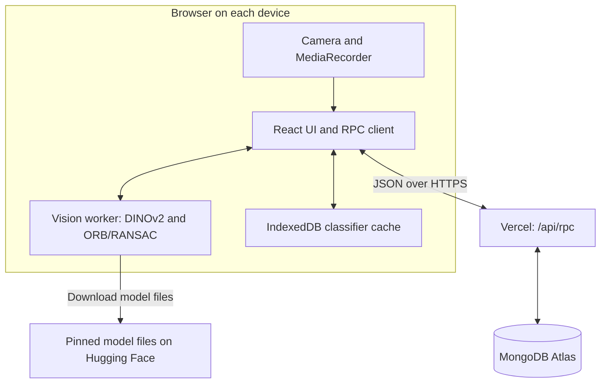
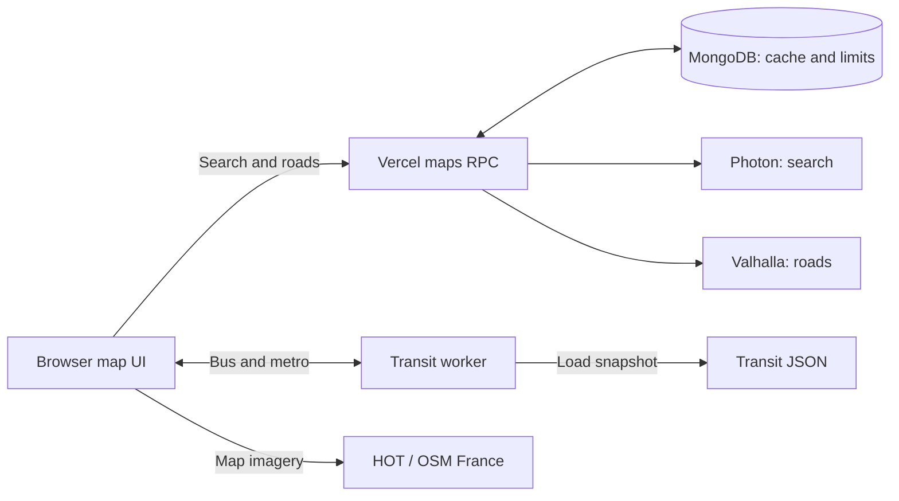

# NoSleepClub HIST

A mobile web proof of concept with two features:

* **Place recognition:** Dev records and names a five-second clip. User points a camera at that place; the app displays its name when visual evidence is sufficient, or `...` when it is not.
* **Ho Chi Minh City maps:** users choose two points and request walking, motorbike or bus/metro directions inside the app.

[Open the HTTPS app](https://nosleepclub-hist-connected.vercel.app/) · [App QR](docs/qr-app.png) · [UI audit](docs/audit-localization.md) · [Translation review](docs/translation-review.md)


## Try the recognition flow

1. Choose a language, then **Dev**. The browser creates a room if it does not already have a writable one.
2. Start the camera and record five seconds of one area. Give the clip a place name and choose **Save & train**.
3. Wait for training to finish. Open **Library → Room QR** on the Dev device.
4. Scan that room QR on another phone, choose **User**, and start the camera. Both devices now use the same reference set.

The QR above opens the app only. A **room QR** additionally grants access to that room's recordings and recognition references. User and Dev are test modes; they are not account logins. In Vietnamese, these modes are labelled **Người dùng** and **Nhà phát triển**.

Five seconds is the recording duration, not a promise of five-second training or instant startup. A new device must download and initialize the vision backbone. Once ready, a strong match can return a name from the first processed frame. Later views still need visual overlap with the recorded place.

## Architecture and data flow

React coordinates the camera, workers, cache and API calls. The vision worker extracts features and predicts places; it does not upload recordings or call the room API itself.



[Open the rendered architecture SVG](docs/architecture-1.svg) if your Markdown viewer does not render Mermaid.

**Data boundaries:** User camera frames stay in the browser. When Dev confirms a save, the client uploads the original video, a thumbnail and extracted reference features. It also saves the fitted classifier. Vercel validates and stores these objects in MongoDB; it does not run DINOv2 inference. Changing the interface language does not rename footage, modify references or retrain the model.

| Source | Responsibility |
| --- | --- |
| [App.tsx](src/App.tsx) | Role flow, camera lifecycle, recording, training and evaluation |
| [client.ts](src/client.ts) | JSON RPC, room capabilities, chunked video transfer and worker requests |
| [vision.worker.ts](src/vision.worker.ts) | Backbone loading, embeddings, ORB extraction and geometric matching |
| [fewshot.ts](src/fewshot.ts), [evidence.ts](src/evidence.ts), [recognition.ts](src/recognition.ts) | Classifier fitting/ranking, acceptance rules, quality checks and temporal confirmation |
| [model-cache.ts](src/model-cache.ts), [shared.ts](src/shared.ts) | IndexedDB cache and shared feature/model types |
| [MapsPanel.tsx](src/maps/MapsPanel.tsx), [transit.ts](src/maps/transit.ts) | Map interactions, route verification and transit search |
| [i18n/](src/i18n/) | Six-language UI, progress/error localization and font selection |
| [rpc.ts](server/rpc.ts), [validation.ts](server/validation.ts) | Authorization, upload lifecycle, quotas and input validation |
| [db.ts](server/db.ts), [maps.ts](server/maps.ts) | MongoDB connection/indexes and cached map-provider requests |
| [api/](api/) | Vercel HTTP entry points |

## Run locally

Requirements: a patched **Node 24.x release, at least 24.22.1**, npm, and a MongoDB database reachable by the API server. The declared Node range is `>=24.22.1 <25`.

```powershell
npm ci --ignore-scripts
Copy-Item .env.example .env.local
# Edit .env.local and set MONGODB_URI before starting the API.
npm run dev
```

Open `http://127.0.0.1:5173`. Vite proxies `/api` to the local API at `127.0.0.1:8787`. Frontend edits reload automatically; restart the dev command after backend edits. A phone needs the HTTPS deployment for camera access. Localhost HTTP works for testing on the development computer.

| Environment variable | Meaning |
| --- | --- |
| `MONGODB_URI` | Required by the API; use a TLS connection URI with database-scoped credentials |
| `MONGODB_DB` | Optional database name; defaults to `nosleepclub_hist` |

Keep credentials server-side. Variables prefixed with `VITE_` are exposed to client code. Environment files, recordings, dependency caches, temporary tools and generated build output are ignored by Git.

```powershell
npm run typecheck
npm test
npm run build
npm audit --audit-level=high
```

Build checks TypeScript, copies ONNX Runtime WASM assets with `scripts/assets.mjs`, and produces `dist` with Vite. WASM and fonts are served by the app; model weights are downloaded from Hugging Face. Keep `assetsInlineLimit: 0`, because the production `font-src 'self'` policy does not allow inlined font data URLs.

`GET /api/health` pings MongoDB. A successful health response confirms database connectivity, not camera permission, model readiness or map-provider availability. `npm run preview` serves the frontend build; a local API process is still needed for database-backed operations.

## How recognition works

### Terms used in code

| Term | Meaning in this project |
| --- | --- |
| Backbone | Frozen pretrained DINOv2 model used to extract image features |
| Embedding | A normalized vector of 384 numbers describing an image |
| Prototype | A representative embedding fitted from a labelled group of frames |
| Support frame | A retained reference embedding and its ORB keypoints/descriptors |
| Inlier | A keypoint match consistent with the estimated geometric transformation |
| Classifier artifact | Versioned prototypes, support frames, labels and training metadata |
| Held-out clip | A separately recorded test clip that is excluded from reference training |

### Capture and fitting

The client samples frames every 200 ms during recording. Quality filtering runs at capture time; expensive feature extraction runs after recording stops. The quality check uses a consistent 256 px scale and accepts mean luminance in `[18, 240]` with Laplacian variance at least `65`. This rejects many dark, overexposed or blurred frames, but is not a perfect motion-blur detector.

Up to eight time bins retain their sharpest frame. A stationary recording remains valid. The crop matches the live viewfinder's `object-fit: cover`, with its longer side reduced to at most 512 px. DINOv2 Small q8 produces the embedding; OpenCV extracts up to 250 ORB points distributed across a 4×4 grid, with 32-byte descriptors. The exact backbone ID and pinned revision are in [vision.worker.ts](src/vision.worker.ts).

Training fits a small classifier over these frozen features; it does not fine-tune DINOv2. Labels are grouped with NFC normalization and case folding. Each class receives up to three spherical prototypes, fitted over six iterations. Support selection keeps at most 24 frames across all classes, with a per-class budget of 2–8. Background examples form a rejection class.

### Prediction and rejection

For normalized embeddings, cosine similarity is the dot product `s(q, x) = q · x`. Ranking uses each class's best prototype or support score, preserving distinct viewpoints instead of averaging all views together.

The current v3 decision path is:

1. Consider up to three classes with semantic score `≥ 0.60`; compare up to four support frames per candidate.
2. Match ORB descriptors using Hamming distance `< 64`, Lowe ratio `< 0.75` and unique reference matches.
3. Estimate a homography with RANSAC: 4 px reprojection tolerance, 600 iterations, confidence `0.995`.
4. Count geometric evidence only when there are at least 10 inliers, an inlier ratio `≥ 0.35`, and an inlier bounding-box area covering `≥ 0.025` of the query image.
5. Accept a non-background winner only with **at least 12 inliers**. When a competitor has inliers, require `bestInliers ≥ 1.35 × secondInliers + 3`.
6. Confirm immediately with **24 inliers**, or with 12 inliers plus a fast semantic match. Otherwise require two consistent predictions. A weak or unfamiliar frame clears the result to `...`.

A fast semantic match must exceed the fitted `fastThreshold` in `[0.95, 0.995]` and have a score gap of at least `0.04`. The artifact also stores a fitted `threshold` in `[0.88, 0.94]`; **that field is not an acceptance gate in the current v3 predictor**. Geometric evidence remains mandatory even for high semantic scores. See [fewshot.ts](src/fewshot.ts) and [evidence.ts](src/evidence.ts) for the actual decision path.

Results without fresh confirmation expire after `clamp(1.8 × inferenceLatency + 120 ms, 2500 ms, 5000 ms)`. Similarity and inlier counts are comparison metrics, not calibrated probabilities. The app recognizes the visible scene; it does not determine the holder's coordinates, gaze or a 3D room position. Repeated patterns, changed objects and large lighting/viewpoint changes can cause rejection or mistakes.

### Reusing and evaluating a trained model

Feature version: `dinov2-small-q8-orb-v1`. Classifier version: `fewshot-dinov2-v3`. The client checks these versions and sorted source footage IDs before reuse. It tries IndexedDB, then the room's MongoDB artifact. If neither artifact matches, it fits from stored reference features. Only a writable room can save the new artifact remotely; User mode can cache it locally.

Use held-out clips for evaluation. Reports separate correct, incorrect and uncertain predictions, including unknown scenes that were wrongly accepted. Frames from one clip are correlated; this report alone is not an independent accuracy benchmark.

The WASM backbone uses one thread for device compatibility. OpenCV allocations are released explicitly. Its module is thenable: wait for runtime initialization rather than awaiting the module object directly.

## API, permissions and storage

All app operations use `POST /api/rpc` with a JSON `action`. Room operations also supply `roomId` and a capability `key`. Zod validates input dimensions, descriptor lengths, chunk sizes and model references. Unknown internal errors are not shown verbatim in the UI.

| Action | Required access | Purpose |
| --- | --- | --- |
| `workspace.create` | Public; rate limited | Creates a room and returns read/write keys |
| `workspace.get` | Read or write | Lists footage; read access sees ready clips only |
| `footage.create` | Write | Reserves storage and creates pending metadata |
| `footage.chunk`, `footage.frames` | Write | Uploads numbered video parts and feature pages |
| `footage.complete` | Write | Checks uploaded counts before marking footage ready |
| `footage.delete` | Write | Removes footage/features and invalidates the saved model |
| `media.get`, `frames.get` | Read or write | Downloads video parts or feature pages |
| `model.get` | Read or write | Loads the room's fitted classifier |
| `model.save` | Write | Stores a classifier if its dataset version/references are still current |
| `maps.search`, `maps.route` | Public; rate limited | Searches places or requests road routing |

Read and write keys each contain 32 random bytes. MongoDB stores SHA-256 hashes; authorization compares them in constant time. The creator's browser retains the write key. Room QR links carry the read key in a URL fragment; the app stores it and removes the fragment from the visible URL. A room UUID alone grants no access. Losing browser storage can lose write access; account recovery is not implemented.

Video upload is staged: create metadata → upload 256 KiB parts → upload features → complete. This keeps individual JSON requests below the API body limit; video parts are base64 encoded in transit and stored as BSON Binary. Pending or incomplete clips do not become recognition sources. On failure, the client attempts cleanup and retains the unsaved draft for retry/download; leftover pending clips can be removed in Dev.

| MongoDB collection | Contents / index |
| --- | --- |
| `workspaces` | Unique room ID, key hashes, reservation, dataset version and model artifact |
| `footages` | Unique footage ID; room, label, kind, status, counts, thumbnail and reservation |
| `chunks` | Video binary; unique `(footageId, n)` |
| `frames` | Feature objects; unique `(footageId, n)` |
| `quota` | Application reservation counter |
| `limits` | Rate-limit / provider-lease buckets; TTL expiry |
| `maps_cache` | Hashed request key and response; 24-hour TTL |

Application limits are 24 MiB/video, 80 feature frames/video, 12 clips/room, 96 MiB reserved/room, 360 MiB reserved/app, 40 rooms/app and five new rooms/IP/hour. Each clip reserves its declared video size plus 2 MiB overhead. JSON request bodies are limited to 700,000 bytes. These are prototype controls; cross-collection operations are not one ACID transaction. Atlas has additional resource limits. Footage remains until Dev deletes it.

Each function process reuses a MongoDB pool of five with 8-second connection/selection timeouts. Connection initialization ensures indexes idempotently.

## Maps and transit routing



[Open the rendered maps SVG](docs/architecture-2.svg) if your viewer does not render Mermaid. Location and route queries go to the relevant services; camera images do not. Tile requests also reveal the viewed map area to the tile provider.

Users can search explicitly with the magnifier/Enter, type `latitude,longitude`, choose one of ten curated destinations, or place A/B pins. Pin controls support drag-and-drop and tap-then-place; existing markers are draggable. Editing an endpoint invalidates the previous route and any pending result. Geolocation permission is requested only by **My location**.

The curated records in [landmarks.ts](src/maps/landmarks.ts) distinguish the city museum at 65 Lý Tự Trọng, the Tuệ Thành/Thiên Hậu temple in Cholon, and the Bến Dược entrance for Củ Chi. Củ Chi is marked as a separate excursion; the cathedral pin is an exterior viewpoint. A map coordinate does not guarantee an open entrance, and the ten sites are not proposed as one walk.

### Walking and motorbike

Valhalla uses `pedestrian` and `motor_scooter` respectively, with `shortest: true`; motor-scooter routing also disables hierarchy pruning. Distance is optimized within the provider's OSM graph and access rules. Requests are limited to latitude `[10.25, 11.4]`, longitude `[106.15, 107.4]`, and 60 km straight-line separation.

Responses contain route geometry, distance, estimated time and maneuvers. English uses upstream instructions. Vietnamese and the other locales translate structured maneuver types, preserving source street names and roundabout exit numbers. There is no live traffic or continuous turn-by-turn position tracking.

### Bus and metro

The committed EBMS snapshot contains 5,721 stops, 334 directed bus variants and two Metro 1 directions; results show the snapshot date. Source flags are handled conservatively. For example, the API labels Văn Thánh as “Chưa khai thác”, so the snapshot excludes local boarding/alighting there without asserting that the real station is closed.

The transit worker builds stop nodes and directed line-position nodes, then searches with a binary min-heap Dijkstra. It uses this preference score, in metre-equivalent units:

```text
score = ride distance between stops + 4 × walking distance + 1200 × boardings
```

The walking multiplier discourages long walks; the boarding penalty discourages transfers. For example, 1,000 m of riding, 100 m of walking and one boarding score `1000 + 400 + 1200 = 2600`. That is a search score, not a 2.6 km trip or a travel-time estimate.

Initial candidates use the nearest 12 stops within 1 km of each endpoint, transfers within 240 m, up to three boardings/two transfers, and a 2,400 m straight-line walking budget. A boarding must include a ride edge before alighting. Line-shape clipping advances monotonically through stop positions, including loops.

The UI verifies proposed walking legs against Valhalla's street network, allowing up to 1,400 m access/egress and 650 m per transfer. Failed connections are blocked and up to four alternatives are tried. Verified geometry replaces straight connectors; the final walking total may exceed the preliminary straight-line budget. Ride costs also use approximate inter-stop distances, so this constrained snapshot search does not guarantee a globally optimal or earliest-arrival journey.

There are no fares, timetable, wait times, last-service or live-disruption data. Users must check stop signs, direction and operating service. Refresh the public dataset explicitly with `node scripts/fetch-transit.mjs`; the importer throttles requests, resumes work cached for up to 24 hours, and does not run during builds.

The map API caches responses for 24 hours and uses MongoDB leases to space upstream requests by about 1.15 seconds per provider. It allows 150 map requests/IP/hour, with 10-second search and 14-second route timeouts. Community providers serve this free, low-traffic demo; higher traffic needs suitable providers or self-hosting.

## Languages and interface

Each fresh entry offers English, Vietnamese, Korean, Simplified Chinese, Japanese and Russian. English remains the default. The last choice is highlighted but does not bypass the entry screen. **Library → Language** changes the interface without clearing the current room or reference set.

| Language | Display / body fonts |
| --- | --- |
| English and Vietnamese | Phudu / Be Vietnam Pro, with Vietnamese glyphs |
| Korean | Noto Serif KR Variable |
| Simplified Chinese | Noto Serif SC Variable |
| Japanese | Noto Serif JP Variable |
| Russian | Oswald / PT Sans, including Cyrillic |

CJK/Cyrillic font CSS loads on selection. Catalog checks cover every locale and interpolation parameter. Vietnamese runtime messages use registered source templates; unexpected messages still receive a safe localized fallback. Footage labels, street/stop names and line headsigns retain their source proper names. Map tile text and browser permission prompts are outside the app's translation catalog.

The paper/ink interface uses editable SVG ornaments, including a temporary dragon recreated from the user's sketch. Camera occupies most of the workspace; library, QR and evaluation use a focus-trapped drawer. Mobile inputs are at least 16 px and main controls target 44 px. Reduced motion bypasses the animated curtains/typewriter. See the linked audits for tested viewports and the limits of synthetic camera tests.

## Deployment and troubleshooting

GitHub `main` is connected to Vercel project `nosleepclub-hist`. Builds output `dist`; functions run in `sin1` with a 30-second limit. GitHub Actions runs typecheck, tests, build and dependency audit. A release is complete only when CI passes, Vercel is READY for the same commit, and the public alias passes an HTTPS smoke check.

`MONGODB_URI` is a sensitive production server variable. Protected previews do not receive that credential. Atlas M0 is in the separate `NoSleepClub_HIST` test project with a database-scoped read/write user. The owner approved `0.0.0.0/0` network access for this test because Vercel egress IPs vary; TLS and credentials remain required.

CSP limits scripts/fonts to self and allows the model-delivery hosts. OpenCV requires `unsafe-eval` only in its worker policy. Framing and MIME sniffing are disabled; camera/geolocation are self-only and microphone access is denied. Room-key leakage or compromised browser storage can expose that room. Identity-based accounts, key recovery, an operator console and production service guarantees are not implemented.

| Symptom | Check |
| --- | --- |
| Camera will not start | Use HTTPS or localhost, allow site camera permission, and close other apps using the camera |
| Model is still preparing | First-use downloads require a network connection; backbone startup is separate from recording duration |
| A phone has no references | Open the room QR from Dev; the generic app QR grants no room access |
| Camera displays `...` | Check lighting, sharpness and visual overlap; add a clearer reference rather than treating a low score as a known place |
| Saving fails | Keep/download the draft, check connectivity and storage limits, then retry; remove unused/pending clips in Dev |
| Maps are unavailable | Check API health, provider availability and rate limits; try a nearby street point or explicit coordinates |

## References and verification records

* [DINOv2](https://github.com/facebookresearch/dinov2), [Transformers.js](https://huggingface.co/docs/transformers.js/), [OpenCV feature homography](https://docs.opencv.org/4.x/d1/de0/tutorial_py_feature_homography.html)
* [Valhalla API](https://valhalla.github.io/valhalla/api/route/api-reference/), [Photon](https://github.com/komoot/photon), [OSM attribution](https://www.openstreetmap.org/copyright), [OSM France](https://www.openstreetmap.fr/)
* [Technical research](docs/research.md), [recognition validation](docs/validation.md), [five-second audit](docs/audit-five-second.md), [map/UI audit](docs/audit-indochine-maps.md), [localization audit](docs/audit-localization.md), [translation/motion review](docs/translation-review.md), [Vietnamese and README verification](docs/audit-vietnamese-readme.md)

Historical audits describe the versions they tested. Current behavior is defined by the code; synthetic tests do not establish real-world recognition accuracy or current transit operation.
