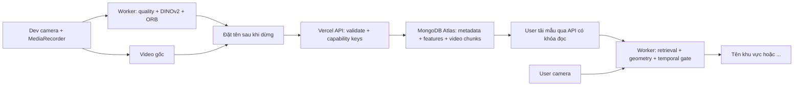

# NoSleepClub HIST

Web test trên điện thoại: **Dev quay footage và đặt tên khu vực → chia sẻ QR của phòng → User dùng camera để nhận diện**. Khi không đủ bằng chứng, User hiển thị `...`.

**[Mở bản test HTTPS](https://nosleepclub-hist-connected.vercel.app/)** · [QR mở app](docs/qr-app.png) · [Audit](docs/audit.md)


Hai vai trò là **chế độ test**, không phải tài khoản đăng nhập hoặc hệ thống phân quyền theo danh tính. Quyền dữ liệu của từng phòng được bảo vệ riêng bằng khóa ngẫu nhiên: QR chỉ có khóa đọc; thiết bị tạo phòng giữ khóa ghi.

## Dùng bản triển khai

1. Mở trang chủ bằng Safari hoặc Chrome, chọn **Dev**. Một phòng test được tạo và ghi nhớ trên trình duyệt.
2. Bật camera, chấp nhận quyền camera. Chờ model tải xong lần đầu. App ưu tiên camera sau và không xin micro.
3. Bấm **Bắt đầu quay**. Mỗi footage chỉ chứa một khu vực; quay chậm, thay đổi nhẹ góc và khoảng cách. Bấm **Dừng quay**, đặt tên rồi lưu.
4. Quay thêm các góc nhìn của cùng nơi với cùng tên. Nên thử ít nhất hai nơi khác nhau và một footage **cảnh khác** để hỗ trợ từ chối.
5. Mở **QR của phòng**, quét bằng điện thoại khác và chọn **User**. Các thiết bị phải dùng đúng QR phòng để có cùng bộ mẫu.
6. Ở User, bật camera. App chỉ hiển thị tên sau khi đủ bằng chứng hình ảnh và ba lượt xác nhận liên tiếp. **Cập nhật mẫu** để lấy footage mới của Dev.

QR ở trang chủ chỉ mở app. QR sau khi tạo phòng mở cùng bộ dữ liệu và mang quyền đọc dữ liệu phòng đó. Chỉ chia sẻ QR phòng cho người được xem footage. Không đăng QR phòng vào repo public.

Nếu trình duyệt trong app nhắn tin chặn camera, mở link bằng Safari/Chrome. Camera web cần HTTPS hoặc localhost. Tắt camera khi rời tab; nếu đang quay, app dừng và vẫn yêu cầu đặt tên trước khi lưu.

## Nhận diện

- DINOv2 Small q8 trích 384 đặc trưng toàn ảnh trong Web Worker. Model và revision được khóa; không dùng LLM để đoán tên.
- Lọc ảnh bằng độ sáng, độ nét Laplacian và số chi tiết ORB. Đây là bộ lọc chất lượng thực dụng, không thể phát hiện hoàn hảo mọi kiểu motion blur.
- Tránh giữ các frame liên tiếp gần như trùng nhau; tối đa 80 frame được chọn cho một footage. Video gốc vẫn được lưu đầy đủ sau khi người Dev đặt tên.
- Tìm ảnh tham chiếu tương tự, kiểm tra ngưỡng và khoảng cách với nhãn đứng thứ hai / mẫu cảnh khác. Kiểm tra hình học ORB + ratio test + RANSAC homography trên ít nhất hai frame tham chiếu.
- User cần ba kết quả liên tiếp cùng tên. Frame không rõ làm kết quả về `...`; kết quả cũ hết hạn sau 2,5 giây khi chưa có frame xác nhận mới.
- Điểm cosine và số inlier là chỉ số đối chiếu, **không phải xác suất nhận diện đúng**. Ngưỡng ban đầu chưa được hiệu chỉnh bằng căn phòng thật của người dùng.
- Footage chọn **Kiểm thử riêng** bị loại khỏi tập tham chiếu. Chạy kiểm thử trong Dev để đo đúng / nhầm / chưa chắc và cảnh lạ bị nhận nhầm trên bộ này.

Đây là nhận diện **khung cảnh camera đang thấy**, không đo vị trí người cầm máy, tọa độ, hướng nhìn của mắt hoặc bản đồ 3D. Hai góc gần giống, thay đồ đạc, thiếu sáng và ít texture có thể gây từ chối hoặc nhầm. Không có cam kết đúng 100%; ưu tiên từ chối khi bằng chứng yếu.

## Kiến trúc



Video được chia thành phần 256 KiB để không đẩy cả file qua giới hạn payload của Vercel Functions. Phân trang frame; chỉ footage tải đầy đủ mới được làm tham chiếu. Mất mạng khi lưu giữ video trong phiên để thử lại hoặc tải xuống; footage dở được dọn khi có thể và có thể xóa trong Dev.

MongoDB chứa `workspaces`, `footages`, `frames`, `chunks`, `limits`, `quota`. Video chunks dùng BSON Binary; không đưa footage vào GitHub. Vercel chỉ giữ secret `MONGODB_URI` ở phía server. Khóa đọc/ghi được lưu dạng hash trên database; khóa ghi không có trong QR. User camera không được gửi lên server.

Giới hạn bản test: 24 MiB/video, 80 frame/footage, 12 footage/phòng, hạn mức lưu dự trữ 96 MiB/phòng và 360 MiB toàn app; hạn chế tạo phòng theo IP và tổng số phòng. Dữ liệu giữ tới khi Dev xóa. Chưa có đăng nhập người dùng, khôi phục khóa Dev, quản trị vận hành hoặc phân quyền sản xuất. Mất bộ nhớ trình duyệt có thể mất quyền ghi; hãy giữ video gốc cần thiết.

## Chạy cục bộ

Cần Node 24 đã vá; quá trình kiểm tra dùng **24.22.1**.

```powershell
npm ci --ignore-scripts
Copy-Item .env.example .env.local
# Điền MONGODB_URI trong .env.local, không đưa vào Git.
npm run dev
```

Mở `http://127.0.0.1:5173`. `server/dev.ts` chỉ lắng nghe localhost. Mô hình được tải từ Hugging Face lần đầu; inference chạy trên trình duyệt. Asset WASM được phục vụ cùng app, sinh bởi `scripts/assets.mjs`, không lưu vào Git.

```powershell
npm run typecheck
npm test
npm run build
npm audit
```

## Triển khai

Repo GitHub public kết nối project Vercel `nosleepclub-hist`, framework Vite, output `dist`, region `sin1`. Đặt `MONGODB_URI` dưới dạng secret cho Production; không dùng tiền tố `VITE_`. Preview giữ bảo vệ đăng nhập và không được cấp secret production. Production mở để test trên điện thoại.

Atlas M0 nằm trong **project riêng NoSleepClub_HIST**. Chủ tài khoản đã chấp thuận ngày 28/10/2026 việc mở network access `0.0.0.0/0` cho project test để Vercel với IP thay đổi kết nối. TLS và credential chỉ có quyền `readWrite` trên `nosleepclub_hist` vẫn bắt buộc. Khi chuyển sang production, chọn kết nối có egress cố định và thu hẹp access list.

Xem [khảo sát và lựa chọn kỹ thuật](docs/research.md), [kế hoạch kiểm chứng](docs/validation.md) và [audit](docs/audit.md).
