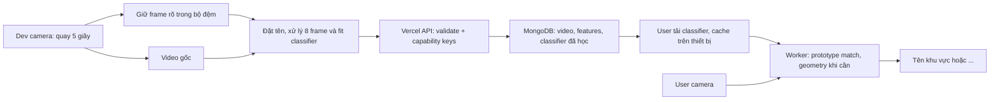

# NoSleepClub HIST

Web test trên điện thoại: **Dev quay footage và đặt tên khu vực → chia sẻ QR của phòng → User dùng camera để nhận diện**. Khi không đủ bằng chứng, User hiển thị `...`.

**[Mở bản test HTTPS](https://nosleepclub-hist-connected.vercel.app/)** · [QR mở app](docs/qr-app.png) · [Audit bản 5 giây](docs/audit-five-second.md)


Hai vai trò là **chế độ test**, không phải tài khoản đăng nhập hoặc hệ thống phân quyền theo danh tính. Quyền dữ liệu của từng phòng được bảo vệ riêng bằng khóa ngẫu nhiên: QR chỉ có khóa đọc; thiết bị tạo phòng giữ khóa ghi.

## Dùng bản triển khai

1. Mở trang chủ bằng Safari hoặc Chrome, chọn **Dev**. Một phòng test được tạo và ghi nhớ trên trình duyệt.
2. Bật camera, chấp nhận quyền camera. App ưu tiên camera sau và không xin micro. Có thể quay trong lúc model đang chuẩn bị.
3. Bấm **Quay mẫu 5 giây**. Giữ camera tương đối ổn định ở một khu vực; video tự dừng. Đặt tên rồi bấm **Lưu & huấn luyện**. Các frame được xử lý sau khi dừng, không phụ thuộc tốc độ inference trong lúc quay.
4. Đợi báo bộ mẫu đã học và sẵn sàng. Một video đủ để tạo mẫu đầu tiên cho một khu vực; không bắt buộc nhiều video. Có thể bổ sung **cảnh khác** để hỗ trợ từ chối.
5. Mở **QR của phòng**, quét bằng điện thoại khác và chọn **User**. Các thiết bị phải dùng đúng QR phòng để có cùng bộ mẫu.
6. Ở User, bật camera. Khớp mạnh trả tên từ frame đầu; bằng chứng vừa phải cần thêm một frame. **Cập nhật mẫu** để lấy footage mới. Model của phòng được lưu trên MongoDB và cache trên thiết bị, không train lại khi chỉ chuyển User.

Footage đã lưu trước cập nhật vẫn dùng được. Dev có nút **Huấn luyện từ footage đã lưu**. Lần đầu trên thiết bị mới cần tải / khởi tạo backbone; thời gian này khác với thời gian nhận diện khi model đã sẵn sàng.

QR ở trang chủ chỉ mở app. QR sau khi tạo phòng mở cùng bộ dữ liệu và mang quyền đọc dữ liệu phòng đó. Chỉ chia sẻ QR phòng cho người được xem footage. Không đăng QR phòng vào repo public.

Nếu trình duyệt trong app nhắn tin chặn camera, mở link bằng Safari/Chrome. Camera web cần HTTPS hoặc localhost. Tắt camera khi rời tab; nếu đang quay, app dừng và vẫn yêu cầu đặt tên trước khi lưu.

## Nhận diện

- DINOv2 Small q8 trích 384 đặc trưng toàn ảnh trong Web Worker. Model và revision được khóa; không dùng LLM để đoán tên.
- Lọc ảnh bằng độ sáng, độ nét Laplacian và số chi tiết ORB. Đây là bộ lọc chất lượng thực dụng, không thể phát hiện hoàn hảo mọi kiểu motion blur.
- Giữ các frame rõ trong 5 giây, rồi chọn tối đa 8 frame trải đều thời gian để trích đặc trưng. Không loại sạch video đứng yên vì ảnh gần trùng. Video gốc vẫn được lưu đầy đủ sau khi người Dev đặt tên.
- Fit bộ phân loại few-shot với các prototype theo nhãn và các ảnh hỗ trợ. Đây là học bộ phân loại nhẹ trên đặc trưng DINOv2 có sẵn, không fine-tune toàn bộ backbone. Artifact `fewshot-dinov2-v2` được lưu trên MongoDB; phía User ưu tiên tải artifact gọn và cache IndexedDB.
- Dùng khớp tốt nhất phù hợp với góc nhìn hiện tại; không lấy trung bình bắt buộc với góc khác không chồng lấn. Khớp rất mạnh và cách biệt nhãn đối thủ trả tên ngay; mức yếu hơn cần ORB + RANSAC với một frame hỗ trợ rõ. Không bắt buộc hai ảnh hỗ trợ cùng khớp.
- Bằng chứng hình học mạnh cũng trả tên ngay; mức vừa phải cần hai lượt cùng tên. Frame không rõ làm kết quả về `...`; kết quả cũ hết hạn sau 2,5 giây khi chưa có xác nhận mới.
- Điểm cosine và số inlier là chỉ số đối chiếu, **không phải xác suất nhận diện đúng**. Ngưỡng ban đầu chưa được hiệu chỉnh bằng căn phòng thật của người dùng.
- Footage chọn **Kiểm thử riêng** bị loại khỏi tập tham chiếu. Chạy kiểm thử trong Dev để đo đúng / nhầm / chưa chắc và cảnh lạ bị nhận nhầm trên bộ này.

Đây là nhận diện **khung cảnh camera đang thấy**, không đo vị trí người cầm máy, tọa độ, hướng nhìn của mắt hoặc bản đồ 3D. Hai góc gần giống, thay đồ đạc, thiếu sáng và ít texture có thể gây từ chối hoặc nhầm. Không có cam kết đúng 100%; ưu tiên từ chối khi bằng chứng yếu.

## Kiến trúc



Video được chia thành phần 256 KiB để không đẩy cả file qua giới hạn payload của Vercel Functions. Phân trang frame; chỉ footage tải đầy đủ mới được làm tham chiếu. Mất mạng khi lưu giữ video trong phiên để thử lại hoặc tải xuống; footage dở được dọn khi có thể và có thể xóa trong Dev.

MongoDB chứa `workspaces`, `footages`, `frames`, `chunks`, `limits`, `quota`. Video chunks dùng BSON Binary; không đưa footage vào GitHub. Vercel chỉ giữ secret `MONGODB_URI` ở phía server. Khóa đọc/ghi được lưu dạng hash trên database; khóa ghi không có trong QR. User camera không được gửi lên server.

Giới hạn bản test: 24 MiB/video, 80 frame/footage, 12 footage/phòng, hạn mức lưu dự trữ 96 MiB/phòng và 360 MiB toàn app; hạn chế tạo phòng theo IP và tổng số phòng. Dữ liệu giữ tới khi Dev xóa. Chưa có đăng nhập người dùng, khôi phục khóa Dev, quản trị vận hành hoặc phân quyền sản xuất. Mất bộ nhớ trình duyệt có thể mất quyền ghi; hãy giữ video gốc cần thiết.

## Chạy cục bộ

Cần Node 24 đã vá; quá trình kiểm tra dùng **24.22.1**.

```powershell
npm ci --ignore-scripts
Copy-Item .env.example .env.local
# Điền MONGODB_URI trong .env.local, không đưa vào Git.
npm run dev
```

Mở `http://127.0.0.1:5173`. `server/dev.ts` chỉ lắng nghe localhost. Mô hình được tải từ Hugging Face lần đầu; inference chạy trên trình duyệt. Asset WASM được phục vụ cùng app, sinh bởi `scripts/assets.mjs`, không lưu vào Git.

```powershell
npm run typecheck
npm test
npm run build
npm audit
```

## Triển khai

Repo GitHub public kết nối project Vercel `nosleepclub-hist`, framework Vite, output `dist`, region `sin1`. Đặt `MONGODB_URI` dưới dạng secret cho Production; không dùng tiền tố `VITE_`. Preview giữ bảo vệ đăng nhập và không được cấp secret production. Production mở để test trên điện thoại.

Atlas M0 nằm trong **project riêng NoSleepClub_HIST**. Chủ tài khoản đã chấp thuận ngày 28/10/2026 việc mở network access `0.0.0.0/0` cho project test để Vercel với IP thay đổi kết nối. TLS và credential chỉ có quyền `readWrite` trên `nosleepclub_hist` vẫn bắt buộc. Khi chuyển sang production, chọn kết nối có egress cố định và thu hẹp access list.

Xem [khảo sát và lựa chọn kỹ thuật](docs/research.md), [kế hoạch kiểm chứng](docs/validation.md) và [audit bản 5 giây](docs/audit-five-second.md). [Audit v1](docs/audit.md) giữ làm hồ sơ phiên bản cũ.
